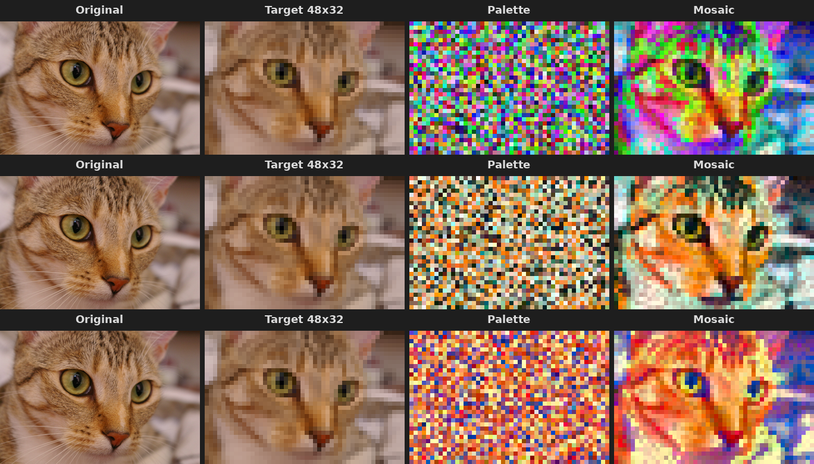
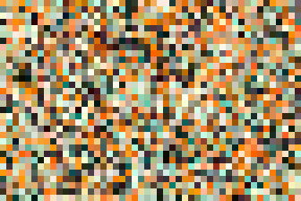
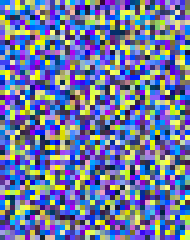
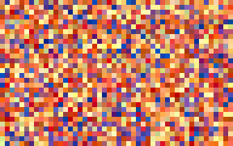
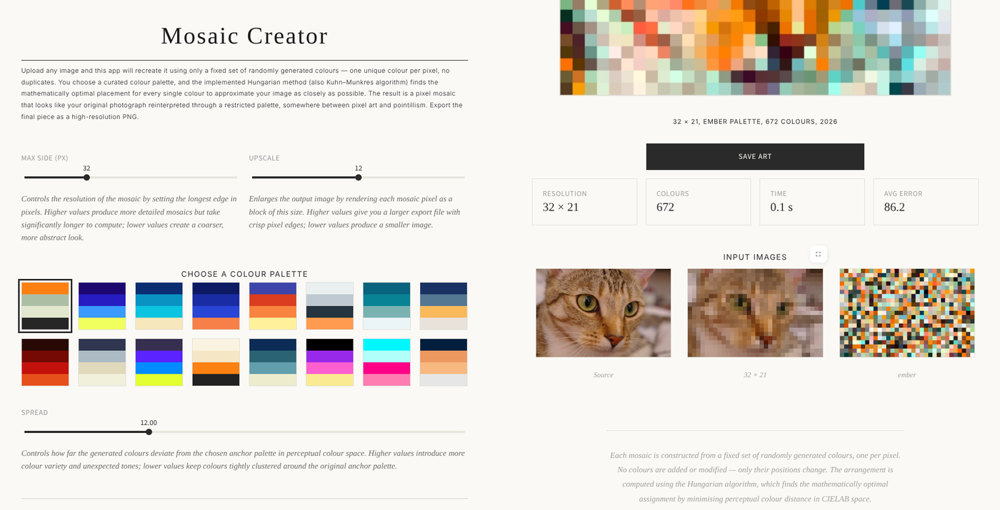

# Pixel Mosaic Generator

[](https://github.com/econlabs/pixel_mosaic/actions/workflows/ci.yml)
[](https://www.python.org/downloads/)
[](LICENSE)
[](https://github.com/astral-sh/ruff)

Recreate any image as a **pixel mosaic** using a fixed set of randomly generated colours: one unique colour per pixel, no duplicates. The image is downscaled to a configurable resolution (preserving aspect ratio), a palette is generated to match the total pixel count, and an optimal or heuristic solver assigns each colour to the grid position where it best approximates the original. No colours are added or modified; only their positions change.

<p align="center">
  
</p>
<p align="center"><sub>Rows: <code>random</code>, <code>ember</code> and <code>solstice</code> palettes; 48×32 target (1,536 colours), Hungarian solver. Sample image: <code>skimage.data.chelsea()</code> (CC0).</sub></p>

## Gallery

Each animation starts from the shuffled palette (pure noise) and shows simulated annealing swapping pixel positions until the picture emerges. No colour is ever changed, only moved.

<table>
  <tr>
    <td align="center"></td>
    <td align="center"></td>
    <td align="center"></td>
  </tr>
  <tr>
    <td align="center"><sub><code>ember</code> · 48×32 · 1,536 colours<br>error 84.2 · optimum 81.1</sub></td>
    <td align="center"><sub><code>voltage</code> · 38×48 · 1,824 colours<br>error 139.3 · optimum 135.0</sub></td>
    <td align="center"><sub><code>solstice</code> · 48×30 · 1,440 colours<br>error 128.0 · optimum 120.9</sub></td>
  </tr>
</table>

<sub>Simulated annealing with 60,000 iterations; palette seed 42. The annealing run itself is random, so the final error varies slightly between runs. Error is the mean RGB distance between target and mosaic; the optimum is the Hungarian solution, the best achievable value for the same palette. Sources: <code>skimage.data.chelsea()</code> (CC0); Edvard Munch, <i>The Scream</i> (1893) and Vincent van Gogh, <i>The Starry Night</i> (1889), both in the public domain.</sub>

## Features

- **Variable resolution**: configurable `max_side` (default 32 px); the image's aspect ratio is preserved, so the grid adapts to each input
- **Two solvers**: optimal [Hungarian algorithm](https://en.wikipedia.org/wiki/Hungarian_algorithm) and tuneable [Simulated Annealing](https://en.wikipedia.org/wiki/Simulated_annealing) with animated GIF export
- **Rich palette system**: 20 preset themes (random, pastel, grayscale, warm, cool, neon, cyberpunk, …), 16 curated anchor palettes (ember, ultraviolet, arctic, …) with adjustable spread, custom hex anchors, or extraction from any source image
- **Perceptual colour matching** in CIELAB space (or RGB)
- **Floyd–Steinberg dithering** post-processing for smoother tonal gradients
- **Batch processing**: drop multiple images in `images/`, run once
- **Comparison grid**: auto-generated side-by-side panels (Original → Target → Palette → Mosaic)
- **Interactive Streamlit app**: gallery-style web UI with clickable palette cards, resolution, upscale and spread sliders, one-click composition and high-res PNG export
- **Modern Python**: `pyproject.toml`, type hints, `typer` CLI, `rich` logging
- **CI**: GitHub Actions running ruff, mypy, and pytest across Python 3.11 / 3.12 / 3.13
- **Docker support** for reproducible builds

## Quick Start

### Install

```bash
git clone https://github.com/econlabs/pixel_mosaic.git
cd pixel_mosaic
pip install -e ".[all]"   # includes dev + streamlit deps
```

### Basic usage

```bash
# Batch mode: process everything in images/
cp your_photo.jpg images/
python main.py batch

# Single image
python main.py single photo.jpg -o output/result.png
```

### Streamlit app

```bash
streamlit run streamlit_app.py
```

The Streamlit app provides an interactive, gallery-style interface:

1. **Upload** any image (JPG, PNG, WebP, BMP, JFIF)
2. **Adjust resolution** via the *Max side* slider (4–100 px); it controls the longest edge, and the short side is computed from the aspect ratio
3. **Choose a colour palette** by clicking one of 16 curated anchor-palette cards (ember, ultraviolet, arctic, cobalt, solstice, …)
4. **Tune the spread** slider to control how far generated colours deviate from the anchor palette in CIELAB space
5. **Set the upscale** factor to control the output image size (each logical pixel becomes an N×N block)
6. Click **COMPOSE**; the Hungarian algorithm finds the optimal colour assignment
7. Click **SAVE ART** to download the result as a high-resolution PNG

<p align="center">
  
</p>

The app displays the mosaic in a framed passepartout view alongside metrics (resolution, number of colours, computation time, average colour error) and a three-panel comparison of the source, downscaled target, and generated palette.

## CLI Reference

```
pixel-mosaic batch [OPTIONS]      Process all images in a folder
pixel-mosaic single TARGET [OPT]  Process a single image
```

### Key options

| Flag                       | Default       | Description                                               |
| -------------------------- | ------------- | --------------------------------------------------------- |
| `--max-side` / `-m`     | `32`        | Longest side of the downscaled image (aspect ratio preserved) |
| `--solver`               | `hungarian` | `hungarian` (optimal) or `annealing` (heuristic)       |
| `--seed` / `-s`        | `42`        | Random seed for palette generation (`None` = random)    |
| `--color-space`          | `lab`       | `lab` (perceptual) or `rgb`                            |
| `--palette` / `-p`      | `random`    | Palette mode: preset name, anchor palette name, or `anchors` |
| `--anchors`              | none          | Comma-separated hex colours for `anchors` mode, e.g. `#FF7F11,#262626` |
| `--spread`               | `12.0`      | Anchor spread in CIELAB units (~5 = tight, ~25 = wide)   |
| `--dither / --no-dither` | off           | Floyd–Steinberg error diffusion                          |
| `--upscale` / `-u`     | `12`        | Output pixel size multiplier                              |
| `--palette-from`         | none          | Extract palette from an image file                        |
| `--sa-iter`              | `2000000`   | Simulated Annealing iterations                            |
| `--sa-gif / --no-sa-gif` | on            | Save SA convergence animation                             |
| `--verbose` / `-v`     | off           | Debug logging                                             |

### Available palette presets

`random`, `pastel`, `grayscale`, `warm`, `cool`, `earth`, `neon`, `sunset`, `ocean`, `forest`, `monochrome_red`, `monochrome_blue`, `monochrome_green`, `vintage`, `candy`, `noir`, `ice`, `autumn`, `cyberpunk`, `terracotta`

### Available anchor palettes

`ember`, `ultraviolet`, `arctic`, `cobalt`, `solstice`, `overcast`, `lagoon`, `harbour`, `furnace`, `slate`, `voltage`, `parchment`, `depth`, `phantom`, `neonoir`, `admiral`

### Examples

```bash
# Annealing solver with animation
python main.py batch --solver annealing --sa-iter 3000000

# Use the "arctic" anchor palette with wide spread
python main.py batch --palette arctic --spread 20

# Custom hex anchors
python main.py single portrait.jpg --palette anchors --anchors "#FF7F11,#262626,#ACBFA4"

# Extract palette from a Richter painting
python main.py batch --palette-from richter_painting.jpg

# Higher resolution (64 px longest side)
python main.py single portrait.jpg --max-side 64 --upscale 8

# RGB colour space + dithering
python main.py batch --color-space rgb --dither
```

### Reproducing the README examples

```bash
python -c "import skimage.data as d; from PIL import Image; Image.fromarray(d.chelsea()).save('images/chelsea.png')"

# Comparison grids (the README image stacks the three *_comparison.png files)
for p in random ember solstice; do
  python main.py batch --max-side 48 --upscale 7 --palette $p -o output/$p
done

# Gallery animations (paintings: --palette voltage --upscale 5 and --palette solstice --upscale 7)
python main.py batch --max-side 48 --upscale 7 --palette ember --solver annealing --sa-iter 60000
```

The gallery GIFs keep the first 36 of the 60 recorded frames and every third frame after that, and store only the pixels that change between frames, so each file stays under the 500 KB limit of the pre-commit hook.

## Development

```bash
pip install -e ".[dev]"
pre-commit install

# Run tests
pytest --cov=pixel_mosaic

# Lint
ruff check pixel_mosaic/ tests/
ruff format pixel_mosaic/ tests/

# Type check
mypy pixel_mosaic/
```

## Docker

```bash
docker build -t pixel-mosaic .
docker run -v $(pwd)/images:/app/images -v $(pwd)/output:/app/output pixel-mosaic batch
```

## How It Works

### The Problem

Given *N* colours (randomly generated or sampled from a palette) and a target image downscaled to preserve its aspect ratio with a configurable longest side, find the **bijective mapping** from colours to grid positions that minimises the total perceptual colour distance. The number of colours always equals the number of pixels in the downscaled target (e.g. a 32×24 target uses 768 colours).

### Solvers

**Hungarian Algorithm** models the problem as a [linear assignment problem](https://en.wikipedia.org/wiki/Assignment_problem). Computes an *N × N* cost matrix of pairwise CIELAB distances, then finds the globally optimal assignment in *O(N³)* time via `scipy.optimize.linear_sum_assignment`.

**Simulated Annealing** starts from a random permutation and iteratively swaps two pixel positions. Swaps that reduce error are always accepted; worse swaps are accepted with decreasing probability as the "temperature" cools. Produces a GIF showing the image emerge from noise (see the [Gallery](#gallery)). In one run with the default 2,000,000 iterations on the cat example (`ember`, 48×32) it reached an average error of 82.1, against 81.1 for the optimal Hungarian assignment.

### Palette Generation

Palettes are generated to match the exact pixel count of each downscaled image. Three approaches are available:

- **Preset themes**: 20 built-in generators (random, pastel, grayscale, warm, cool, neon, etc.) that sample colours from themed RGB ranges.
- **Anchor palettes**: 16 curated 4-colour palettes. Colours are expanded to the required count by interpolating between random anchor pairs in CIELAB space with configurable Gaussian spread.
- **Image extraction**: sample colours directly from any source image.

### Dithering

An optional Floyd–Steinberg error-diffusion pass redistributes quantisation error to neighbouring pixels via local swaps, producing smoother gradients without introducing any new colours.

## Project Structure

```
pixel_mosaic/
├── main.py                     # Entry point (delegates to CLI)
├── streamlit_app.py            # Interactive gallery-style web app
├── pyproject.toml              # Packaging, dependencies & tool config
├── Dockerfile
├── LICENSE
├── uv.lock                     # Locked dependency versions
├── .pre-commit-config.yaml     # Pre-commit hooks (ruff, whitespace, file checks)
├── .streamlit/
│   └── config.toml             # Streamlit theme configuration
├── pixel_mosaic/
│   ├── __init__.py             # Public API & version
│   ├── config.py               # Frozen dataclass config (MosaicConfig)
│   ├── cli.py                  # Typer CLI with Rich output
│   ├── palette.py              # Presets, anchor expansion, image extraction
│   ├── color_utils.py          # LAB conversion, cost matrix
│   ├── solver_hungarian.py     # Optimal solver (scipy)
│   ├── solver_annealing.py     # SA solver + GIF export
│   ├── dithering.py            # Floyd–Steinberg post-processing
│   └── image_io.py             # Load, resize, save, comparison grid
├── tests/
│   └── test_mosaic.py          # Test suite
├── docs/                       # README images: comparison grid, app screenshot, gallery/ GIFs
├── images/                     # ← Drop input images here
├── output/                     # ← Results appear here
└── .github/workflows/ci.yml   # GitHub Actions CI
```

## License

MIT, see [LICENSE](LICENSE).
